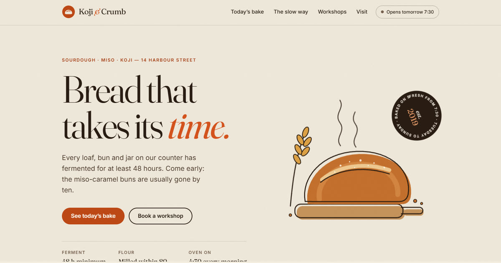

# Kōji & Crumb

A one-page website for a fictional slow-fermentation bakery and café in a harbour town.
Warm, editorial design: cream paper, soy-brown ink and a persimmon accent.

**Live site:** https://minty-web.github.io/1/



## What's inside

- **Today's bake menu** with accessible tabs (arrow keys, Home/End) for breads, pastries, ferments and drinks
- **Live "open now" status** in the header and visit section, worked out from the opening-hours table and the visitor's clock
- **Workshop booking form** with inline validation, seat limits per workshop, and a confirmation message (demo only, nothing is sent)
- **Hand-drawn SVG illustrations**: a steaming loaf, a swaying wheat stalk, an illustrated process timeline and a map of the harbour
- Reveal-on-scroll animations and count-up stats, all switched off for people who prefer reduced motion
- Responsive from 320px phones to wide desktops, with a mobile menu

## Built with

Plain HTML, CSS and JavaScript. No frameworks, no build step.
Fonts: [Fraunces](https://fonts.google.com/specimen/Fraunces) and [Inter](https://fonts.google.com/specimen/Inter).

```
index.html    page structure and content
styles.css    design tokens, layout and animations
script.js     tabs, opening status, booking form, scroll reveals
favicon.svg   logo mark
```

## Run it locally

Open `index.html` in a browser, or serve the folder:

```bash
npx serve .
```

---

Kōji & Crumb is not a real business. Concept site designed and built by [minty-web](https://github.com/minty-web).
